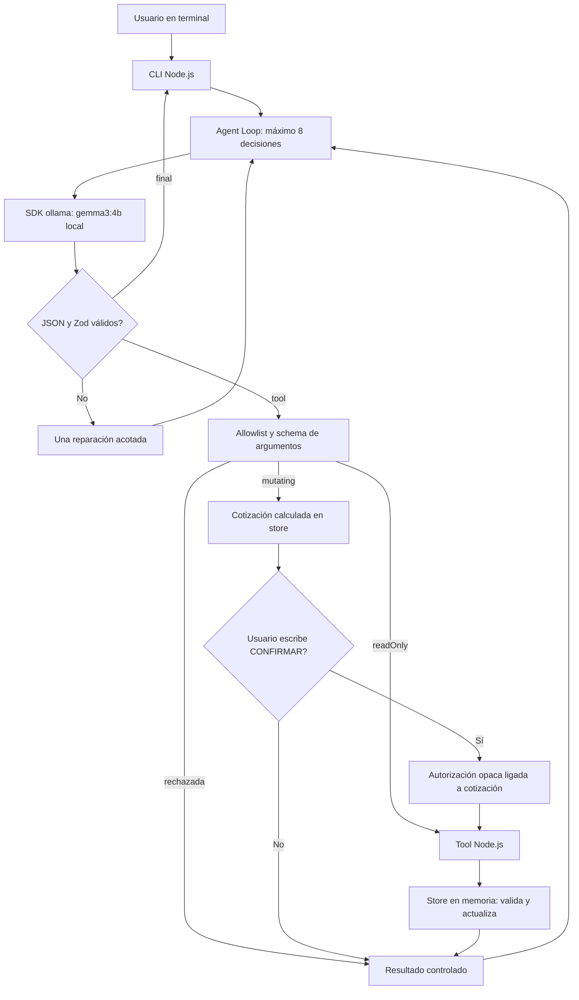
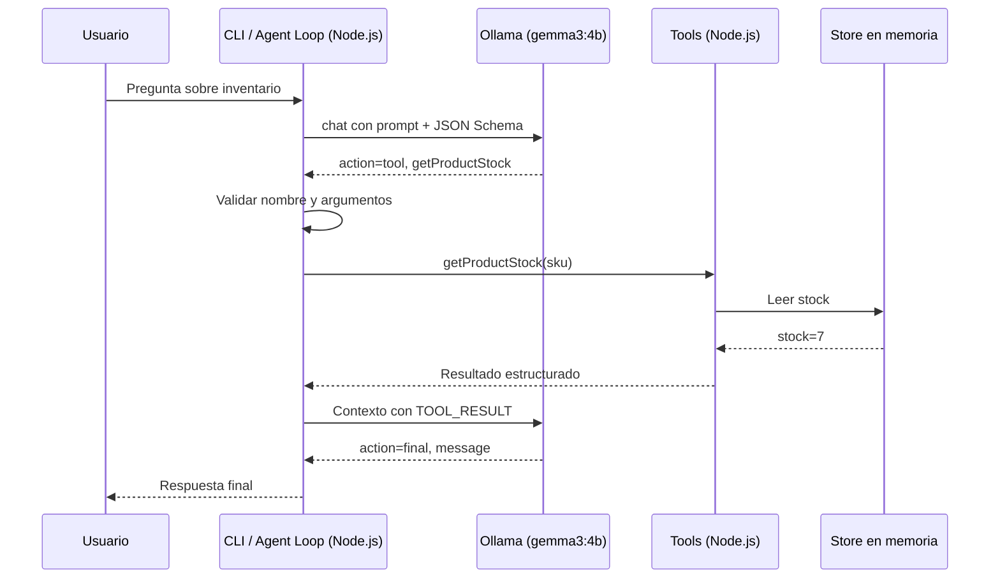
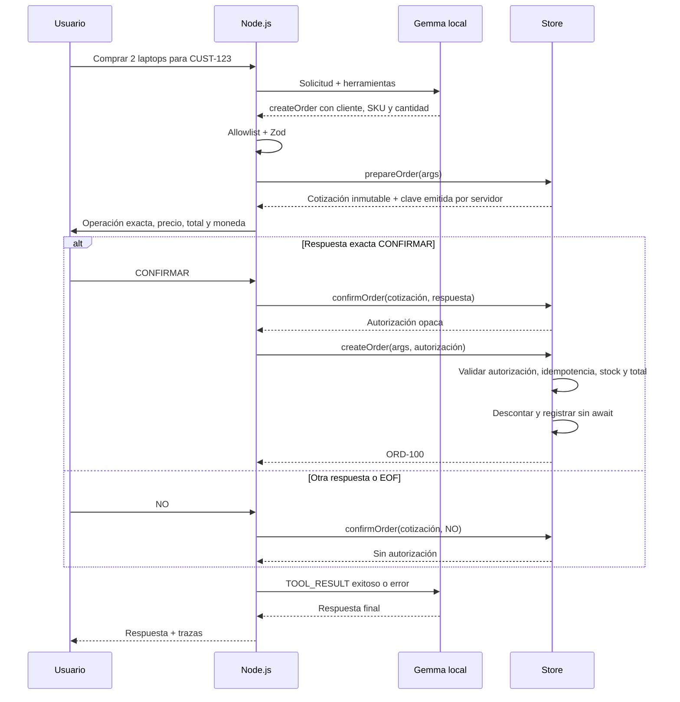

# Arquitectura del demo

El proceso Node.js controla la terminal, los permisos, el almacenamiento y el ciclo. Ollama ejecuta `gemma3:4b` localmente y devuelve texto JSON; no tiene acceso a los objetos de la tienda ni ejecuta funciones JavaScript.



## Contrato de decisiones

Una envoltura plana evita un `oneOf` complejo en un modelo pequeño:

```json
{"action":"tool","toolName":"getProductStock","arguments":{"sku":"LAPTOP-001"},"message":""}
```

```json
{"action":"final","toolName":null,"arguments":{},"message":"Respuesta al usuario"}
```

El JSON Schema limita la forma de la generación. `parseDecision` aplica JSON.parse, límite de tamaño y Zod. Para `final` se exige nombre nulo, argumentos vacíos y mensaje no vacío. Luego `executeTool` usa `Object.hasOwn` para evitar nombres heredados (`constructor`, `__proto__`, etc.) y aplica el schema estricto de la herramienta antes de ejecutarla.

## Secuencia de consulta



## Secuencia de compra



## Fronteras de confianza

- El registro es estático. No hay `eval`, importación dinámica por nombre de herramienta ni shell.
- `prepareOrder` valida datos y calcula el importe. La cotización vive en un WeakMap privado y se devuelve congelada.
- `confirmOrder` solo acepta esa cotización real una vez y el literal `CONFIRMAR`. No está registrada como herramienta. La CLI es el canal confiable que obtiene ese texto del humano.
- La autorización también se verifica por identidad en un WeakMap: conocer o copiar el UUID no permite falsificarla. El LLM nunca recibe la autorización.
- `createOrder` valida cliente/SKU/cantidad de nuevo, compara con la cotización, comprueba stock y precio y actualiza todo síncronamente. Dos operaciones pendientes que compiten por stock no pueden sobrevendérselo.
- El mapa de idempotencia devuelve la misma orden para una autorización ya utilizada. Una autorización para 2 unidades no permite comprar 1 ni cambiar cliente o SKU.
- El código de la aplicación es confiable. Estas medidas no aíslan código JavaScript malicioso ejecutado dentro del mismo proceso; el modelo solo produce datos.

## Historial, límites y errores

`TOOL_RESULT` se añade como mensaje de rol **user**, etiquetado explícitamente como datos de contexto generados por la aplicación. No se usa el rol `tool`: no existe una llamada nativa a la que asociarlo. Las instrucciones y contratos están únicamente en el mensaje `system`. Los resultados nunca se incorporan al system prompt.

Cada llamada al modelo, incluida una reparación, consume una de las ocho decisiones. Tras JSON inválido se permite una reparación consecutiva; un segundo error de formato termina. Después de una decisión válida se puede reparar un nuevo error, sin exceder el presupuesto global. Un JSON excesivo termina directamente.

Tras una mutación exitosa se invalidan las lecturas cacheadas para evitar stock o estados obsoletos; las mutaciones conservan sus resultados. Sin cambios de estado, en un turno una llamada idéntica se ejecuta una vez; su segunda aparición reutiliza el resultado, incluso si fue rechazada. La tercera detiene el turno. Esto evita repetir confirmaciones y compras. El store añade una protección independiente por clave de idempotencia.

El adaptador usa el SDK oficial con fetch cancelable y timeout que cubre la respuesta completa. Se rechazan redirecciones HTTP. Ctrl+C propaga una señal de cancelación desde la terminal al loop y al fetch del SDK; también impide ejecutar herramientas después de cancelar. El límite de generación es 1024 tokens y la salida admitida es de hasta 12000 caracteres. No se muestran errores internos ni stack traces al modelo. Al alcanzar un límite, la respuesta aclara que las operaciones previamente exitosas siguen aplicadas; no hay rollback de todo el turno.

Solo las últimas 24 preguntas/respuestas como máximo pasan a turnos posteriores, con hasta 4000 caracteres por mensaje. Se excluyen roles system externos. `/reset` borra ese historial, conservando la tienda; reiniciar el proceso restaura datos y numeración.

## Pruebas por frontera

| Frontera | Prueba |
|---|---|
| Texto → decisión | `decisionSchema.test.js` |
| Argumentos → negocio | `tools.test.js` |
| LLM → ejecutor → contexto | `runAgent.test.js` con modelo simulado |
| Humano → autorización → mutación | `approval.test.js` |
| Terminal → CLI → loop | `cli.test.js` |
| SDK → HTTP y timeout | `ollamaClient.test.js` con fetch simulado |
| SDK → Gemma local | `ollama.live.js`, ejecución opcional |
