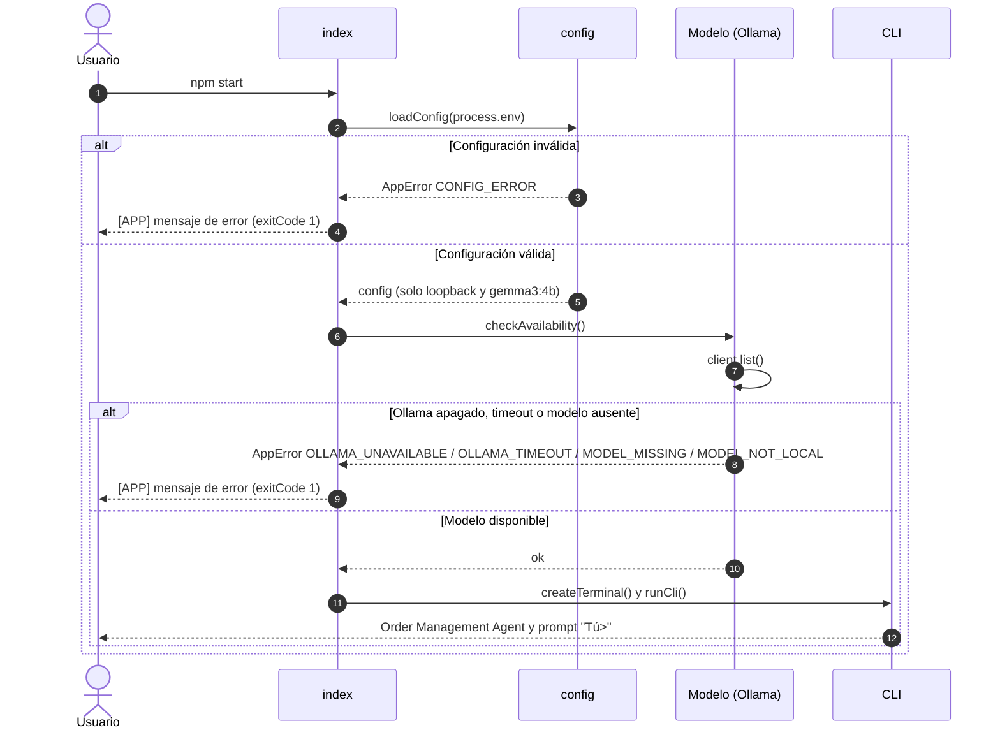
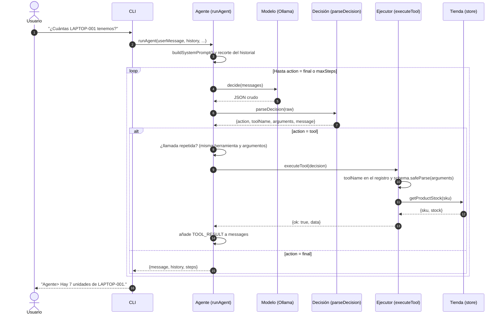
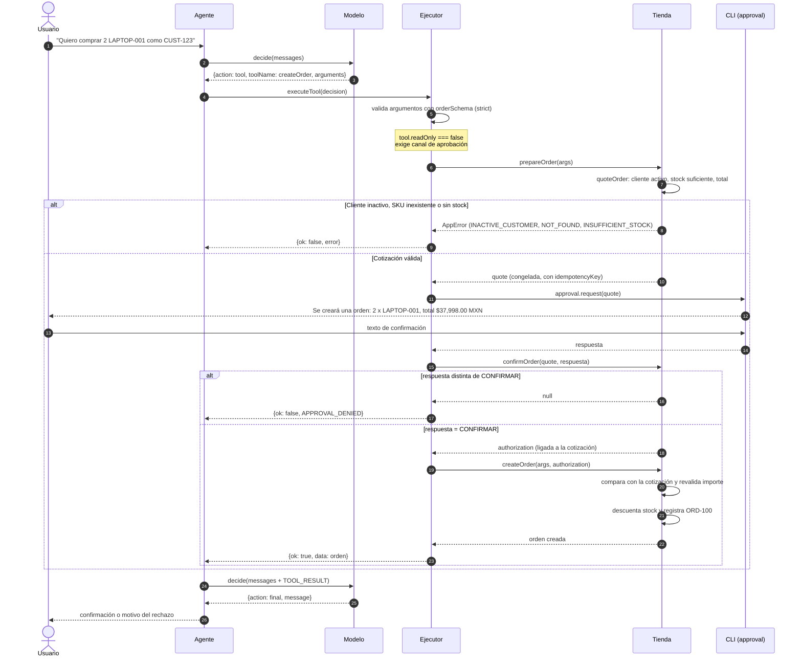
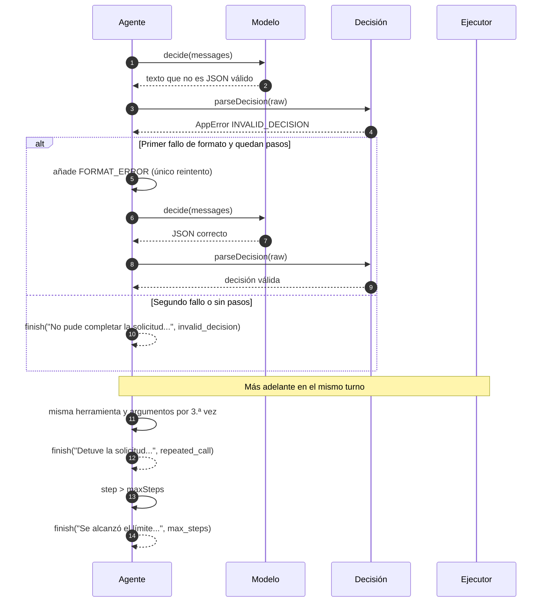
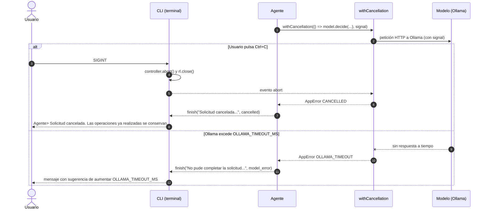
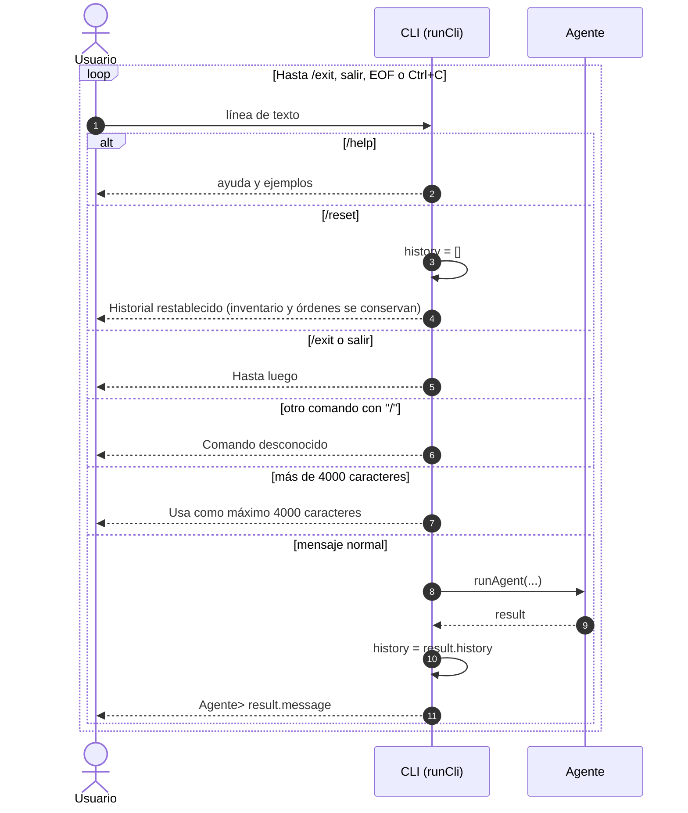

# Diagramas de secuencia

Flujos principales de la aplicación, en formato [Mermaid](https://mermaid.js.org/).
Se renderizan directamente en GitHub, VS Code (con la extensión de Mermaid) y la mayoría de visores de Markdown.

Participantes habituales:

| Participante | Archivo |
| --- | --- |
| `index` | `src/index.js` |
| `CLI` | `src/cli.js` |
| `Agente` | `src/agent/runAgent.js` |
| `Modelo` | `src/agent/ollamaClient.js` (Ollama + `gemma3:4b`) |
| `Decisión` | `src/agent/decisionSchema.js` |
| `Ejecutor` | `src/agent/executeTool.js` |
| `Tienda` | `src/data/store.js` |

## 1. Arranque de la aplicación

`index.js` valida la configuración, comprueba que Ollama y el modelo local estén disponibles
y solo entonces abre la terminal interactiva.

## 2. Turno de conversación con herramientas de solo lectura

Ejemplo: «¿Cuántas LAPTOP-001 tenemos?». El agente repite el ciclo *decidir → ejecutar → observar*
hasta que el modelo devuelve `action="final"` o se agota `maxSteps` (máximo 8).

## 3. Creación de una orden con confirmación humana

`createOrder` es la única herramienta que modifica datos. El modelo solo la *solicita*:
la autorización la produce la aplicación después de que el usuario escribe exactamente `CONFIRMAR`.
La tienda vuelve a validar todo (cliente activo, stock, importe) dentro de una transacción síncrona.

### Idempotencia y reintentos

Si el modelo repite la misma llamada exitosa, `runAgent` reutiliza el resultado en caché
y no vuelve a pedir confirmación. Si se reintentara a nivel de tienda con la misma
`idempotencyKey`, `createOrder` devuelve la orden ya creada sin descontar stock otra vez.

## 4. Salida inválida del modelo y límites de seguridad

Cubre tres protecciones del bucle del agente: un reintento de formato, el corte por
llamadas repetidas y el límite de pasos.

## 5. Cancelación (Ctrl+C) y tiempo de espera

Una sola `AbortSignal` atraviesa CLI, agente, ejecutor y cliente de Ollama.
Las operaciones ya aplicadas se conservan.

## 6. Comandos locales de la CLI

Los comandos que empiezan por `/` los resuelve la CLI y nunca llegan al modelo.

